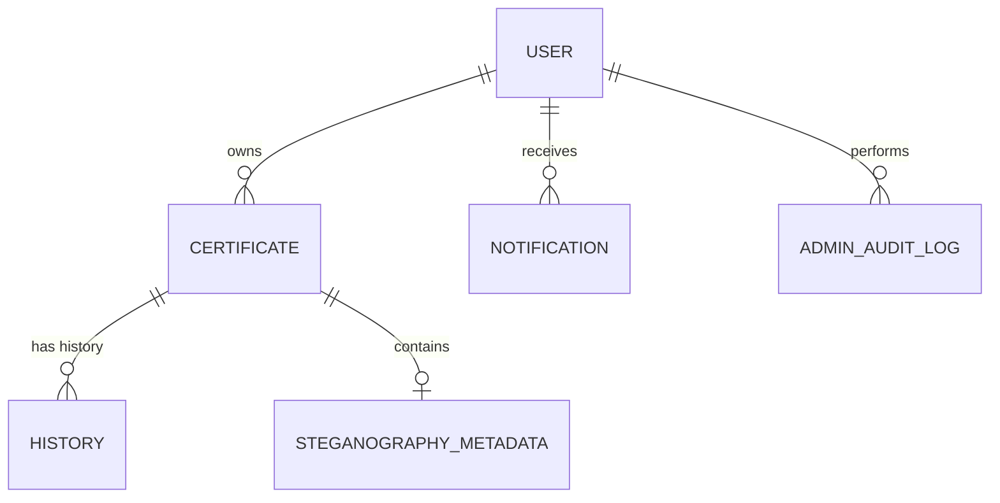

# Web Kripto Steganografi Sertifikat 🛡️📜

Sistem manajemen sertifikat digital berbasis web yang mengintegrasikan teknik **Kriptografi** dan **Steganografi** untuk menjamin keamanan, keaslian, dan integritas data sertifikat. Proyek ini dikembangkan sebagai tugas akhir untuk memfasilitasi pengelolaan sertifikat tanah/sawah secara digital dengan perlindungan data berlapis.

> 🌐 **Live Demo (You can try it):** [https://terrafy-stegano-safety-certificate.vercel.app/](https://terrafy-stegano-safety-certificate.vercel.app/)

## 🌟 Fitur Utama

- **Pendaftaran Sertifikat**: Pengguna dapat mengajukan sertifikat tanah/sawah dengan detail lokasi (koordinat), luas, dan nomor sertifikat.
- **Steganografi LSB (Least Significant Bit)**: Menyembunyikan metadata autentikasi ke dalam citra sertifikat (PNG) tanpa merusak kualitas visual secara signifikan.
- **Verifikasi Keaslian**: Fitur verifikasi mandiri dengan mengunggah sertifikat untuk mengekstraksi pesan tersembunyi dan memvalidasi integritasnya.
- **Pengalihan Hak (Transfer)**: Mekanisme transfer kepemilikan sertifikat yang aman antar pengguna dengan persetujuan admin.
- **Riwayat Kepemilikan (History)**: Pencatatan otomatis setiap aksi (Pendaftaran, Verifikasi, Pengalihan) untuk audit trail yang transparan.
- **Sistem Notifikasi**: Pemberitahuan real-time untuk status verifikasi, penolakan, atau permintaan transfer.
- **Multi-Role User**:
  - **User**: Mengelola sertifikat pribadi, verifikasi, dan transfer.
  - **Admin**: Menyetujui pendaftaran, memantau statistik, dan mengelola audit log.
  - **Dinas**: Akses pengawasan dan pelaporan (Optional/Extended).

## 🎥 Demo Fitur

Berikut adalah demonstrasi penggunaan fitur-fitur utama dalam aplikasi:

### 1. Upload Sertifikat (User)
Proses pengguna mengisi detail sertifikat dan mengunggahnya untuk mengubah menjadi sertifikat digital dengan keamanan steganografi.

<video src="https://github.com/user-attachments/assets/96f3e808-877c-43d2-a94e-af881f959047" controls="controls" style="max-width: 100%;"></video>

### 2. Transfer - Kirim (User)
Mekanisme pengguna mengirimkan permintaan transfer kepemilikan sertifikat kepada pengguna lain.

<video src="https://github.com/user-attachments/assets/31632122-199f-4feb-924b-dd835f2ee6db" controls="controls" style="max-width: 100%;"></video>

### 3. Transfer - Terima (User)
Penerima menyetujui atau melihat sertifikat yang telah ditransfer kepadanya.

<video src="https://github.com/user-attachments/assets/1fc24f6c-860e-4254-878d-069e3c876678" controls="controls" style="max-width: 100%;"></video>

### 4. Verifikasi Transfer (Admin)
Admin memverifikasi dan menyetujui permintaan transfer hak milik untuk memastikan legalitas.

<video src="https://github.com/user-attachments/assets/ca26f244-ade2-4c70-9eab-7193188e9468" controls="controls" style="max-width: 100%;"></video>

### 5. Verifikasi Keaslian (User)
Fitur untuk memvalidasi keaslian sertifikat dengan mengunggah gambar digital dan mengecek metadata tersembunyi.

<video src="https://github.com/user-attachments/assets/cdeaa176-7665-474c-834a-39caf681d88e" controls="controls" style="max-width: 100%;"></video>

## 🛠️ Teknologi yang Digunakan

### Frontend & UI
- **Framework**: [Next.js 16](https://nextjs.org/) (App Router)
- **Styling**: [Tailwind CSS 4](https://tailwindcss.com/)
- **Animasi**: [Framer Motion](https://www.framer.com/motion/)
- **Komponen UI**: [Radix UI](https://www.radix-ui.com/) & [Lucide React](https://lucide.dev/)
- **Chart**: [Recharts](https://recharts.org/)

### Backend & Database
- **Runtime**: Node.js & Next.js Server Actions
- **ORM**: [Prisma](https://www.prisma.io/)
- **Database**: PostgreSQL (Supabase/Local)
- **Authentication**: Bcrypt.js (Password Hashing)

### Keamanan (Kriptografi & Steganografi)
- **PNG Analysis**: [pngjs](https://www.npmjs.com/package/pngjs)
- **Algoritma**: LSB (Least Significant Bit) untuk embedding data.
- **Integritas**: Hash-based validation untuk memastikan data tidak dimanipulasi.

## 📊 Skema Database

Sistem ini menggunakan struktur data relasional untuk menjaga integritas informasi:



## 🚀 Instalasi & Persiapan

1. **Clone Repositori**:
   ```bash
   git clone https://github.com/ridlofw/web-kripto-steganografi-sertifikat.git
   cd web-kripto-steganografi-sertifikat
   ```

2. **Instal Dependensi**:
   ```bash
   npm install
   ```

3. **Konfigurasi Environment**:
   Salin file contoh konfigurasi dan sesuaikan isinya dengan kredensial Anda (Supabase, Database, dll):
   ```bash
   cp .env.example .env
   ```
   Buka file `.env` dan isi variabel berikut:
   - `DATABASE_URL` & `DIRECT_URL` (dari setting Database Supabase)
   - `NEXT_PUBLIC_SUPABASE_URL` & `ANON_KEY` (dari setting API Supabase)
   - `STEGANOGRAPHY_KEY` (WAJIB. 32-byte hex untuk AES-256-GCM: `node -e "console.log(require('crypto').randomBytes(32).toString('hex'))"`)
   - `SESSION_SECRET` (WAJIB. Minimal 32 karakter acak untuk menandatangani cookie sesi, generate dengan perintah yang sama)
   - `SEAL_SIGNING_KEY` (WAJIB untuk menyetujui sertifikat. Seed privat Ed25519, 64 karakter hex. Buat dengan `npm run seal:keygen -- <kid>`, lihat bagian "Segel Bertanda Tangan Digital")
   - `SUPABASE_SERVICE_ROLE_KEY` (Untuk akses storage admin)

4. **Setup Database (Prisma)**:
   ```bash
   npx prisma generate
   npx prisma db push
   npm run seed # Opsional: Untuk data awal admin/user
   ```

5. **Jalankan Aplikasi**:
   ```bash
   npm run dev
   ```
   Akses di `http://localhost:3000`

## 📖 Panduan Penggunaan

1. **Registrasi/Login**: Masuk sebagai User atau Admin.
2. **Pengajuan**: User mengunggah detail sertifikat. Sistem akan melakukan proses steganografi secara otomatis setelah disetujui Admin.
3. **Verifikasi**: Di halaman Verifikasi, unggah file sertifikat PNG yang telah diunduh. Sistem akan mengekstrak metadata dan mencocokkan dengan database.
4. **Transfer**: Masukkan email penerima untuk mengalihkan hak kepemilikan sertifikat.

## ✍️ Segel Bertanda Tangan Digital (v2)

Setiap sertifikat yang disetujui menanam amplop `{v:2, pub, enc, sig}` ke dalam gambar lewat LSB:

- `pub`: data publik yang bisa dibaca siapa saja (ID sertifikat, nomor sertifikat, `verifiedAt`, penerbit "Terrafy", `kid`).
- `enc`: data pemilik, riwayat, dll., dienkripsi AES-256-GCM dengan `STEGANOGRAPHY_KEY`.
- `sig`: tanda tangan Ed25519 atas prefiks domain + `pub` kanonik + `enc` (verifikasi RFC 8032 ketat).

**Verifikasi (`/verifikasi`, publik)**
- Tanda tangan diperiksa di browser (gambar tidak diunggah). Pemeriksaan offline butuh secure context (HTTPS atau localhost); di luar itu tampil "Pemeriksaan offline tidak tersedia".
- Pemeriksaan offline hanya memverifikasi data segel, bukan piksel yang terlihat pada gambar. Selalu bandingkan nomor dan data yang tercetak pada gambar dengan data segel, dan gunakan Cek Status Online untuk status terkini (dicabut, pindah tangan).
- Tombol "Cek Status Online" meminta status terkini ke server (pemilik, transfer, dicabut, segel sudah diganti). Detail pemilik hanya tampil bila gambar adalah segel terbaru.
- Segel lama v1 (hanya AES) masih diterima secara online dan diberi label. Admin dapat menerbitkannya ulang sebagai v2 lewat tombol "Terbitkan Ulang Segel (v2)" di halaman detail sertifikat admin; gambar lama tidak lagi berstatus terbaru.
- Segel v2 yang ditandatangani dengan `kid` lama (bukan `activeKid`) atau `kid` yang dicabut juga dapat diterbitkan ulang dari halaman yang sama ("Terbitkan Ulang Segel (kunci baru)"), sehingga pencabutan kunci tidak membuat sertifikat terkait tanpa segel yang valid.
- `ALLOW_LEGACY_STEGO_KEY=true` membuat segel v1 dapat dipalsukan, karena kunci enkripsi lamanya bersifat publik. Aktifkan hanya sementara sampai semua segel v1 diterbitkan ulang, lalu hapus.

**Manajemen kunci**
- Kunci publik ada di `src/lib/seal/public-keys.ts` (`DEFAULT_KEYRING`: `activeKid`, `publicKeys`, `revokedKids`). Seed privat ada di env `SEAL_SIGNING_KEY`.
- Persetujuan ditolak (tidak ada yang berubah) bila kunci hilang atau tidak cocok dengan kunci publik aktif.
- Rotasi: buat `kid` baru, tambahkan ke `publicKeys`, set `activeKid`. Pertahankan `kid` lama agar segel lama tetap valid.
- Kebocoran kunci: pindahkan `kid` ke `revokedKids`; segel yang ditandatangani dengannya gagal verifikasi. Setelah rotasi, terbitkan ulang segel tersebut dari halaman admin.

```bash
npm run seal:keygen -- terrafy-2026-1   # cetak seed privat dan kunci publik
```

**Checklist deployment**
- Set `SEAL_SIGNING_KEY`, `STEGANOGRAPHY_KEY`, dan `SESSION_SECRET` di environment deployment.
- Database yang sudah ada: jalankan `prisma/sql/2026-10-23-seal-v2.sql` sekali (idempoten, transaksional), misalnya di SQL editor Supabase. Setup baru memakai `setup_database.sql` atau `prisma db push`.
- Pakai HTTPS agar pemeriksaan offline berfungsi.
- Cek online dibatasi 20 request/menit per IP (in-memory, per instance server). Pembatas memakai nilai pertama header `x-forwarded-for`, yang dapat diisi sendiri oleh klien kecuali reverse proxy menimpanya (Vercel melakukannya; `next start` polos atau nginx dengan `proxy_add_x_forwarded_for` tidak). Deploy di belakang proxy yang menimpa/menetapkan header ini; tanpa itu pembatas mudah dilewati. Hal yang sama berlaku untuk pembatas login.

## 🧪 Testing

```bash
npm run typecheck          # TypeScript (build juga gagal bila ada error tipe)
npm test                   # unit test: steganografi, LSB, segel (envelope, tanda tangan, pemeriksaan offline), sesi, storage
```

Test integrasi menjalankan seluruh alur (registrasi, approval + segel stego, transfer, verifikasi publik)
terhadap PostgreSQL sungguhan. **Gunakan database kosong khusus test: semua tabel dihapus setiap test.**

```bash
createdb terrafy_test
DATABASE_URL=postgresql://postgres@localhost:5432/terrafy_test npx prisma db push
TEST_DATABASE_URL=postgresql://postgres@localhost:5432/terrafy_test npm run test:integration
```

Database test harus memakai skema terbaru (`prisma db push` seperti di atas, ulangi setelah skema berubah).
Tanpa `TEST_DATABASE_URL`, test integrasi otomatis di-skip.

### Struktur Kode Inti

| Lokasi | Isi |
|---|---|
| `src/lib/actions/*.ts` | Server action tipis: cek sesi, parsing input, panggil service |
| `src/lib/certificates/*` | Logika bisnis (registrasi, transfer, approval, verifikasi, query) yang bisa diuji langsung |
| `src/lib/steganography.ts` | Pembungkus `pngjs` (sisi server): decode/encode PNG dengan batas jumlah piksel |
| `src/lib/seal/lsb.ts` | Tata letak bit LSB pada kanal RGB (format stabil, kompatibel dengan sertifikat lama), dipakai server dan browser |
| `src/lib/seal/*` | Segel v2: `envelope`, `verify`, `public-keys`, `local-check`, `browser-reveal`, `png-header` aman dipakai di browser; `sign.ts` hanya untuk server (memegang kunci privat) |
| `src/lib/certificates/{sealing,reissue}.ts` | Penerbitan segel bertanda tangan dan penerbitan ulang (v1, `kid` lama, atau `kid` dicabut) |
| `src/lib/certificates/payload.ts` | Enkripsi AES-256-GCM + hash payload segel |
| `src/lib/session.ts`, `src/lib/auth-guard.ts` | Cookie sesi bertanda tangan + otorisasi berbasis role di database |

## 👥 Tim Pengembang

- **Abid** - [GitHub](https://github.com/abidclassroomgit)
- **Ridlo** - [GitHub](https://github.com/ridlofw)
- **Rahman** - [GitHub](https://github.com/auliagin344-web)
- **Wisam** - [GitHub](https://github.com/babykiminjeong-dev)
- **Riziq** - [GitHub](https://github.com/Asenn4)

---
*Proyek ini merupakan bagian dari tugas akhir mata kuliah Kriptografi.*
